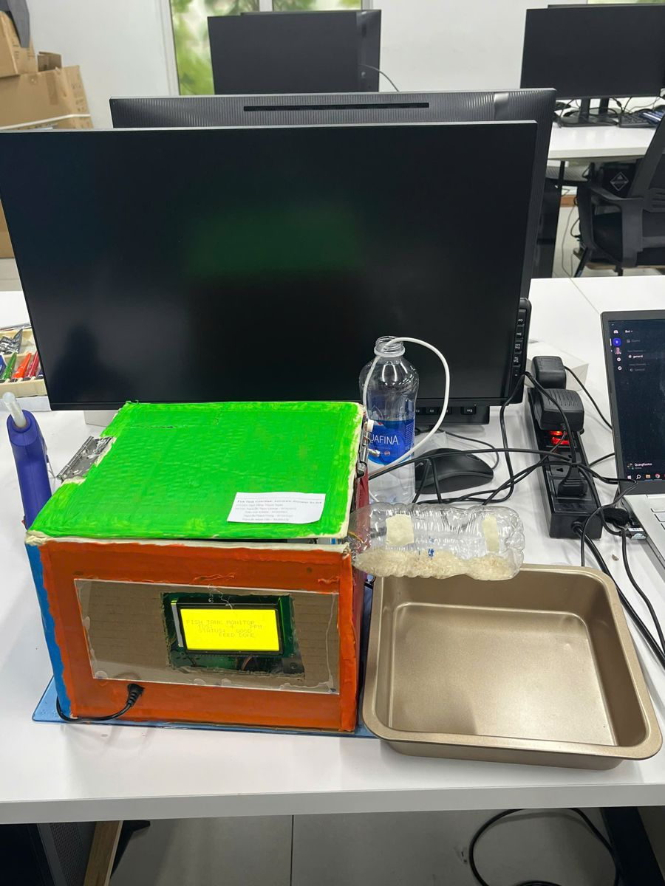
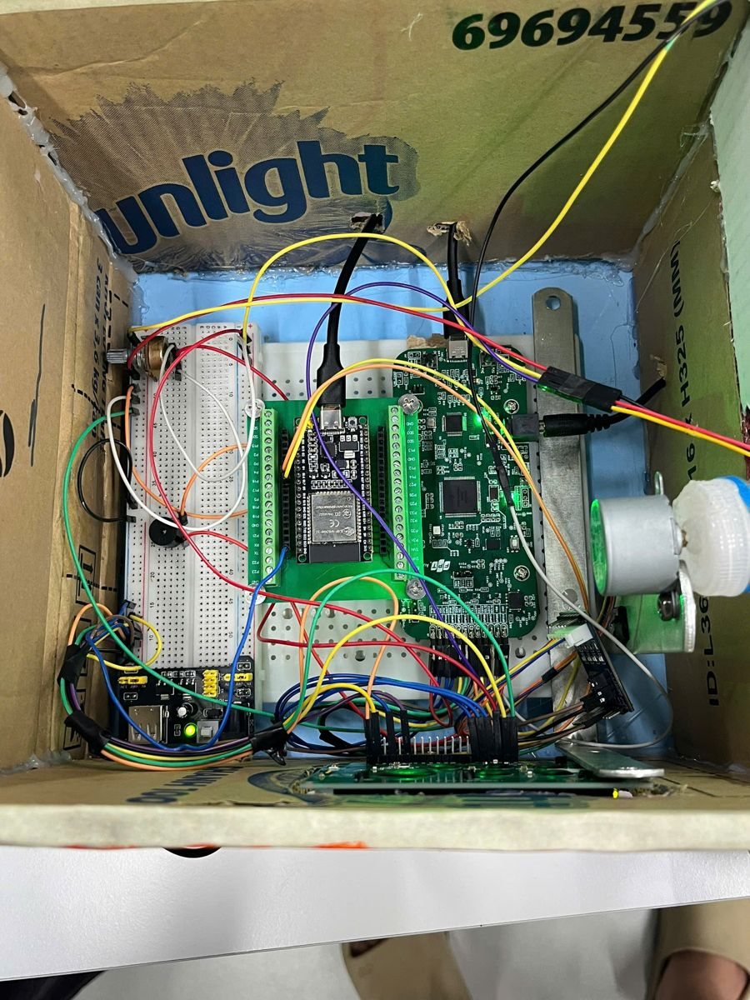
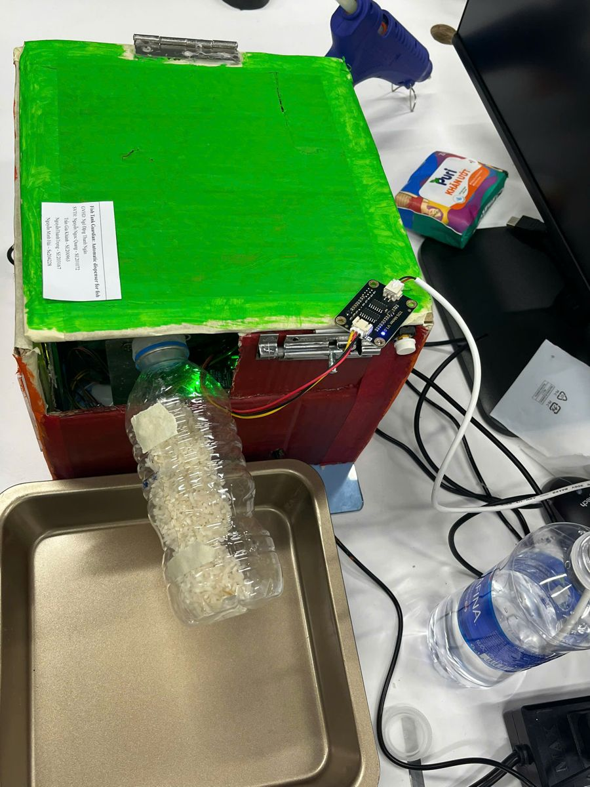

# Fish Tank Guardian – Automatic Fish Feeder

A fish feeder that can be triggered remotely and reports back its status. Team of 3. I came up with the idea and handled most of the system, including the UART link between the two microcontrollers; one teammate worked with me on the water-quality (TDS) sensor, and another on the Adafruit IO part.



## Architecture
```
Adafruit IO (MQTT) ──► ESP32 gateway ◄── UART 9600 8N1 ──► S32K144 (MaaZEDU board)
Serial Monitor ──────►      │                                   ├─ feeder motor
                            └──► Discord webhook (status)       ├─ TDS sensor
                                                                └─ physical feed button
```

The ESP32 gateway receives commands from an Adafruit IO feed (or the Serial Monitor), forwards them to the S32K144 over UART, and posts results to a Discord channel.

## UART protocol (ESP32 ⇄ S32K144, 9600 baud)
| Direction | Message | Meaning |
|---|---|---|
| ESP32 → S32K | `F` | Start feeding |
| ESP32 → S32K | `T` | Request TDS reading |
| ESP32 → S32K | `P` | Ping |
| S32K → ESP32 | `READY` / `PONG` | Board ready / UART OK |
| S32K → ESP32 | `FEED_ACK` / `FEED_DONE` | Feeding started / completed |
| S32K → ESP32 | `BUTTON_FEED_ACK` / `BUTTON_FEED_DONE` | Feeding triggered by the physical button |
| S32K → ESP32 | `TDS_ACK`, `TDS:<value>` | TDS request accepted / reading |
| S32K → ESP32 | `BUSY:<…>` | S32K busy, gateway resets and waits |

The gateway runs a small state machine (`IDLE → WAIT_ACK → RUNNING`) with an ACK timeout (8 s), command resend (every 0.8 s, up to 8 tries), a completion timeout (30 s) and a recovery delay after errors.

## Setup (ESP32 gateway)
1. Install the ESP32 board package and the **Adafruit MQTT Library** in Arduino IDE.
2. In `firmware/esp32_gateway/`, copy `secrets.example.h` to `secrets.h` and fill in your Wi-Fi, Adafruit IO and Discord webhook values. `secrets.h` is git-ignored.
3. Upload `esp32_gateway.ino`.

Wiring: ESP32 GPIO17 (TX2) → S32K PTD6 (LPUART2_RX), GPIO16 (RX2) ← PTD7 (LPUART2_TX), common GND.

Serial Monitor test commands: `feed`, `tds`, `ping`.

## Scope
This repository contains the **ESP32 gateway firmware** only. The S32K144 firmware is not included.

## Photos


